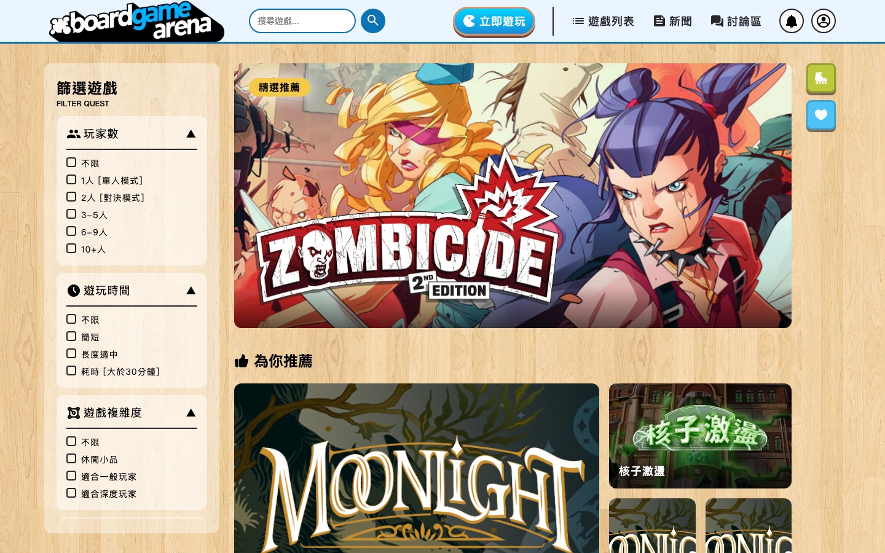
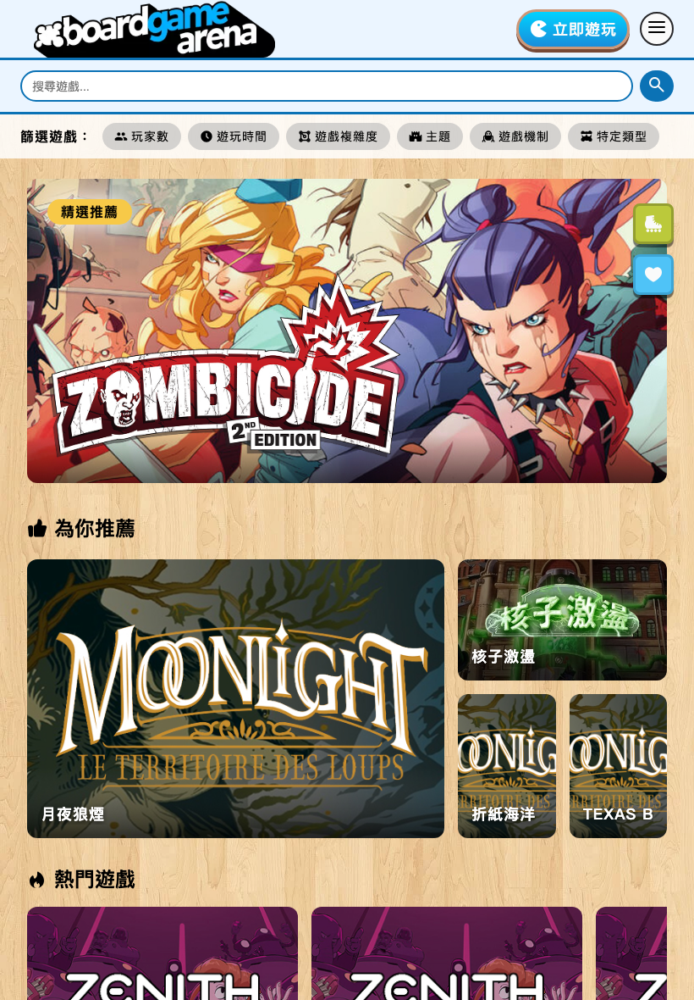

# BGA 首頁改版｜期中專案（HTML / CSS 切版）

Board Game Arena（線上桌遊平台）首頁的第一版改版，用純 HTML 與 CSS 切版。這是資展國際 UX 人機介面網頁設計師養成班的期中專案，**設計稿是我當時的舊版設計**，和我後來完成的改版不同。

> 最新版（Vue 3 + Tailwind CSS，含第二次可用性測試）請看 [bga-redesign](https://github.com/hakukanojyo/bga-redesign)，線上試用：<https://hakukanojyo.github.io/bga-redesign/>

| 桌面（1440px） | 平板（820px） |
| --- | --- |
|  |  |

## 範圍

首頁的下列區塊：

- Header：Logo、搜尋、「立即遊玩」、導覽、通知與個人入口
- 篩選列：玩家數、遊玩時間、遊戲複雜度、主題、遊戲機制、特定類型
- 主要內容：精選推薦、為你推薦、熱門遊戲
- 右側釘選按鈕

## 響應式設計

- **桌面**：側邊篩選欄加主要內容兩欄。
- **平板（max-width: 1024px）**：篩選改為橫向的篩選列，搜尋框移到 Header 下方，導覽收進選單。
- **手機（max-width: 767px）**：這一版**沒有**做手機排版，只加上「建議使用平板或電腦瀏覽」的提示列。手機排版是後續版本才處理。

## 技術

- HTML5、CSS3（Flexbox、Grid、CSS 變數、media query）
- 沒有使用 JavaScript、框架或套件

## 關於 AI 輔助

這個專案的切版有使用 AI 輔助，我負責設計稿、版面結構、各斷點的規劃，並逐段閱讀與修改程式碼。

## 聲明

這是個人學習作品，與 Board Game Arena 官方無關。Logo、遊戲封面與圖片的版權屬於原作者與出版商，僅作為學習展示之用。
